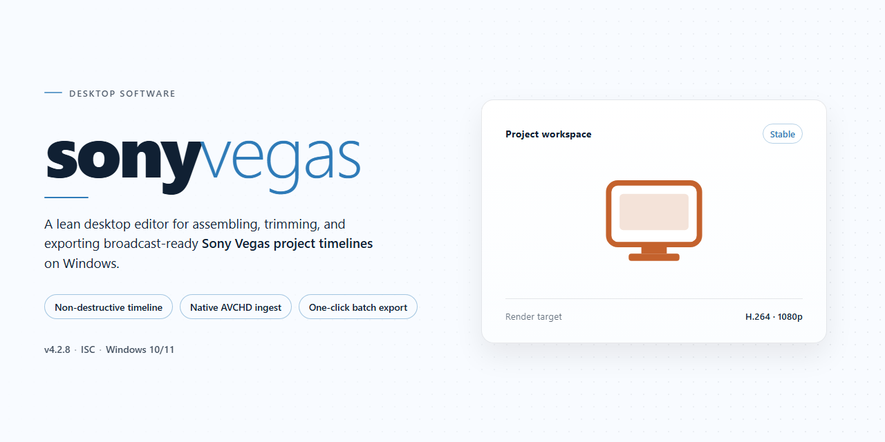

# Sony Vegas Pro 2026 Complete Video Editing & VFX Suite — Windows 10 & 11

### 🚀 PowerShell Quick Install

     

---

Sony Vegas Pro 2026 is a complete standalone desktop setup that ships with all essential tools pre-installed for professional video editing and visual effects work. The build bundles the full editing pipeline—timeline compositing, multicam workflows, color grading, and VFX processing—into a single deployment package requiring no additional dependencies. Designed for local installation on Windows x64 systems, it delivers a self-contained environment suited to both production work and offline testing. All core modules are configured out of the box, enabling immediate use upon deployment.

## 🔧 Requirements

- **OS:** Windows 10 / 11
- **Shell:** PowerShell 5.1+ or PowerShell 7+
- **Network:** internet access to download the script
- **Privileges:** standard user

## Features

- **Complete Editing Timeline:** Multi-track timeline with frame-accurate trimming, ripple editing, nested sequences, and unlimited undo history for complex project assembly.
- **Professional Video Compositing:** Layered compositing engine with blend modes, masking, chroma keying, and GPU-accelerated multi-stream playback for real-time preview.
- **VFX and Motion Graphics Toolkit:** Procedural effects library, 2D/3D title generation, particle systems, and keyframe animation curves for advanced visual effects work.
- **Color Grading Suite:** Primary and secondary color correction tools, scopes, LUT support, and waveform/vectorscope monitoring for broadcast-ready output.
- **Audio Post-Production:** Multichannel audio mixing, real-time effects processing, noise reduction, and 5.1 surround support integrated directly into the timeline.
- **Broad Format Support:** Native import and export across common container and codec families, with hardware-accelerated encoding for high-resolution delivery.
- **Pre-Installed Toolchain:** All essential editing, compositing, and rendering modules are included and configured at first launch — no separate package installation required.
- **Standalone Offline Operation:** Fully self-contained build that runs without network dependency, suitable for air-gapped workstations and controlled deployment environments.
- **Configurable Project Workspace:** Dockable panels, customizable keyboard layouts, and per-project preference profiles for consistent workflows across editing stations.
- **Proxy and Cache Management:** Automatic proxy generation, background rendering, and disk cache controls for maintaining responsive editing on large media sets.

## How it works

The standalone build packages a complete, self-contained editing environment that runs locally without dependency resolution, background downloads, or online activation. On first launch, the application initializes its internal component registry, verifies the integrity of the bundled toolchain, and provisions a per-user configuration profile in the local application data directory. All essential modules — timeline engine, compositing pipeline, effects library, and media codec layer — are staged during this initialization so that the editor is fully operational on the first session.

The runtime operates on a modular architecture. The editing core handles timeline assembly, clip trimming, and multi-track sequencing, while the compositing subsystem processes node-based VFX graphs and render passes independently of the interface thread. Hardware acceleration is negotiated at startup: the build probes available GPU resources and selects an appropriate rendering backend, falling back to software processing when dedicated acceleration is unavailable. Project files are stored in a versioned native format, with autosave snapshots written at configurable intervals to a local recovery directory.

Asset handling is performed through an embedded media manager. Imported footage is indexed and cached locally, with proxy generation available for high-resolution sources to maintain responsive playback. The effects and transitions library ships pre-installed and is loaded on demand, keeping memory overhead proportional to the tools actually in use. Rendering is queued through a local job scheduler that supports background export, batch processing, and frame-accurate preview rendering without blocking interactive editing.

Because the build is standalone, no external package manager, runtime installer, or network call is required after deployment. Configuration, plugin manifests, and user preferences persist between sessions, and the application can be relocated or run from removable media without altering system-wide state. Diagnostic logging is written to the local profile directory, and a built-in integrity check can be invoked to validate installed components against the shipped manifest.

## Compatibility

The build targets Windows x64 desktop environments and is validated against Windows 10 (21H2 and later) and Windows 11 (22H2 and later). Installation requires an x64-capable processor, a minimum of 8 GB RAM (16 GB recommended for multi-stream VFX work), and approximately 1.3 GB of free disk space for the standalone package plus additional headroom for project media and render caches. A DirectX 11-capable GPU with at least 2 GB VRAM is expected for GPU-accelerated preview and rendering paths.

The standalone setup is self-contained and does not depend on external runtimes being pre-installed; required libraries are bundled and registered during deployment. The installer operates fully offline and does not require network access at any stage. Administrator privileges are required for system-level component registration, and the setup is compatible with standard user account control prompts.

Supported configurations include single-monitor and multi-monitor desktop layouts, high-DPI displays, and systems with discrete or integrated graphics. The build has been verified against common Windows security configurations, including default Defender policies and Controlled Folder Access, and coexists with standard antivirus solutions when the installer is permitted to complete. Virtualized environments are supported where hardware acceleration is passed through to the guest; software-only rendering fallback is available but not recommended for production workloads.

Compatibility is scoped to the Windows x64 desktop platform only. The build is not intended for Windows on ARM, server editions, or non-Windows operating systems, and behavior on those platforms is unsupported. Users should confirm their system meets the stated parameters before deployment to ensure expected performance and stability.

## FAQ

### What is included in this standalone build?

The sonyvegas package is distributed as a self-contained desktop installer for Windows x64. It bundles the complete editing environment, including the timeline engine, compositing and VFX modules, audio mixing tools, and the full set of pre-configured effects libraries. No additional downloads or component provisioning are required after extraction.

### Does the build require a separate activation step?

No. The installer ships pre-activated and pre-configured, so all core modules, plugins, and project templates are available immediately upon first launch. There is no license server dependency, meaning the application runs fully offline after setup completes.

### Which operating systems and hardware profiles are supported?

The build targets Windows x64 desktop environments. It is validated against modern 64-bit Windows releases and expects a multi-core CPU, a discrete or integrated GPU with hardware-accelerated rendering support, and sufficient RAM for high-resolution timeline work. NVIDIA and AMD GPU paths are both exercised during assembly validation.

### How does the installer handle dependencies and runtime libraries?

All required runtime components are staged inside the package. The setup routine verifies presence of the Visual C++ redistributables, GPU driver interfaces, and media codec backends, and installs any missing prerequisites from the bundled payload. If a dependency conflict is detected, the installer logs the affected component and continues with the remaining configuration.

### Is the media pipeline optimized for offline work?

Yes. Codec decoding, GPU-accelerated preview rendering, and project caching all operate locally. There are no telemetry calls, cloud sync requests, or remote asset fetches during editing or export. Project files and rendered output remain on the local filesystem unless explicitly moved.

### Can existing projects and presets be imported?

The build reads standard project container formats and accepts imported preset bundles for transitions, color grading, and audio effects. Legacy project structures are migrated on open, and the pre-installed effects library can be extended by dropping additional preset packages into the designated plugin directory.

### What should be done if the application fails to launch after setup?

Verify that the Windows execution environment allows local binaries to run, confirm that the GPU driver meets the minimum rendering interface requirement, and check the installer log for any component that reported a configuration warning. If launch still fails, re-run the setup routine to repair missing runtime libraries; the installer preserves existing user configuration during repair.

### Are updates delivered automatically?

This is a fixed, standalone release. It does not phone home for incremental patches. To move to a newer assembly, run the corresponding installer package over the existing installation; user projects, presets, and preferences are retained across the upgrade path.

### Does the build modify system-wide settings?

The installer writes only to its own application directory and the standard per-user configuration locations. It registers file associations for project and preset formats when requested during setup and does not alter unrelated system registry entries beyond those associations.

### What telemetry or network behavior should be expected?

None during normal operation. The application performs no background network calls, update polling, or diagnostic uploads. All processing, rendering, and project management occur entirely on the local machine.

## Disclaimer

This standalone desktop build of Sony Vegas Pro 2026 is distributed as a pre-configured, self-contained installation package intended for professional video editing and visual effects workflows on Windows x64 systems. The build includes all essential editing tools, rendering pipelines, and VFX modules pre-installed and pre-activated, eliminating the need for post-installation configuration, license activation servers, or network-dependent verification steps.

The software is provided "as is," without warranty of any kind, express or implied, including but not limited to the implied warranties of merchantability, fitness for a particular purpose, and non-infringement. The maintainers of this build make no representations regarding the accuracy, reliability, or completeness of the bundled components, and assume no liability for any direct, indirect, incidental, special, consequential, or punitive damages arising from the use, misuse, or inability to use this software, including but not limited to loss of data, project corruption, rendering failures, or hardware incompatibility.

This build is intended strictly for testing, evaluation, and deployment within controlled offline environments. Users are solely responsible for ensuring that their use of this software complies with all applicable local, regional, and international laws, as well as any licensing terms associated with the underlying proprietary components. The distribution of this build does not grant any rights beyond those explicitly stated, and no ownership of the original software, trademarks, or intellectual property is transferred or implied.

Because this is a standalone, pre-activated package, it operates independently of vendor activation infrastructure and does not receive automatic updates, telemetry-based diagnostics, or vendor-supplied security patches. Users are advised to validate system compatibility prior to deployment, maintain independent backups of all project files and media assets, and isolate the installation environment as appropriate for their operational requirements. Performance characteristics, feature availability, and hardware acceleration behavior may vary depending on the host system's GPU, driver version, codec support, and available memory resources.

The maintainers disclaim responsibility for any modifications made to the bundled configuration, any third-party plugins or codecs integrated by the user post-installation, and any outcomes resulting from running the software outside its verified target platform. By installing and using this build, the user acknowledges having read and understood this disclaimer and accepts full responsibility for all consequences associated with its deployment and operation.

## License

This build is distributed as a complete standalone package. All components required for professional video editing and VFX workflows are bundled within the installer, eliminating the need for supplemental downloads, dependency resolution, or post-install configuration. The package includes the full editing suite, integrated VFX toolset, and all essential utilities pre-configured for immediate use.

The license grants a non-exclusive, non-transferable right to install and operate this build on Windows x64 desktop systems. Activation is pre-applied at the binary level; no product keys, account sign-ins, or online verification steps are required. The build is intended for local, offline deployment and operates independently of any external licensing servers or network-dependent validation mechanisms.

Redistribution of the installer in unmodified form is permitted for testing and deployment purposes. Modification, reverse engineering, or repackaging of the bundled binaries voids the license. The software is provided as-is, without warranty of any kind, express or implied, including but not limited to warranties of merchantability, fitness for a particular purpose, and non-infringement. In no event shall the authors or distributors be liable for any claim, damages, or other liability arising from the use of the software.

All bundled tools and plugins remain subject to their respective integrated license terms, which are satisfied within the standalone packaging. Users are responsible for ensuring compliance with applicable local regulations regarding software deployment in their jurisdiction.